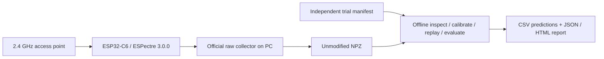

# Technical Design: WiFiPresence MVP

**Version:** 0.5 | **Date:** 2026-10-29 | **Status:** Pilot capture integrated; scientific evaluation incomplete

**Team:** Pan Yiran; Wang Junyang; Xie Hengyuan

## Architecture and Responsibilities



The AP and ESP32 provide a specific wireless link. The official collector produces traffic and saves raw measurements. The original local `wp.py` pipeline operates only on files and never contacts a device. The October 29 extension separately adds `presence.py` and an explicitly started live adapter, described below. Ordinary device motion events pause during raw collection. Restore the previously working traffic source afterward; restarting alone does not clear persistent external mode. ([ESPectre 3.0.0 API](https://github.com/francescopace/espectre/blob/3.0.0/docs/API.md) and [CLI](https://github.com/francescopace/espectre/blob/3.0.0/docs/CLI.md)).

## Technology Choices and Simpler Alternatives

| Choice | Selected approach | Alternative and trade-off |
|---|---|---|
| Compute | Local Python and NumPy | On-device implementation adds firmware work before the method is validated; router deployment remains future work |
| Persistence | Raw NPZ plus JSONL manifest | A database offers little benefit at this size; screenshots alone cannot replay measurements |
| Interaction | CLI and offline HTML/CSV/JSON | A website adds integration work and does not improve the experimental comparison |
| Reference algorithm | Explicit amplitude variation baseline | Phase processing and learned models increase calibration and data requirements |
| Candidate | Hysteresis with persistence | More complex interference features wait for evidence that this simple change is insufficient |

## Data and File Interfaces

`wp.py` delegates to `wifipresence/cli.py`. `core.py` owns validated ingestion, window quality, calibration and state output. `experiments.py` owns manifest checks, reporting, event latency and synthetic fixtures. Tests exercise the data and workflow boundaries.

The supported NPZ profile is `csi_data:int8[N,128]`, 64 logical complex subcarriers in `[Q,I]` order, increasing `device_ticks_us`, and a known requested packet rate. If PHY metadata is present, all three arrays must be present and match record length. Only `ht / ht-ltf / 20` rows enter the view. All-zero rows are excluded; original files are not rewritten. Other raw profiles, partial PHY metadata, invalid time or missing rate for analysis fail clearly. A missing rate can only be replaced by an explicitly known `--expected-pps`, never by guessed received cadence. A conflicting --expected-pps is rejected when the file already records requested_pps; inspection retains the packet-rate source. ([ESPectre 3.0.0 collection guide](https://github.com/francescopace/espectre/blob/3.0.0/docs/ML_DATA_COLLECTION.md)).

Each manifest line contains `trial_id`, `file`, `scenario`, `split`, `room`, `device`. Paths are relative to the manifest. Scenario S1–S6 encodes room truth and fan condition. Split is development, validation, test or exclude. Duplicate IDs and identical file content are rejected across records. Model provenance includes SHA-256 and trial IDs; evaluation rejects any overlap with calibration. This does not detect two separately exported fragments from the same original recording, so the team must preserve independent-recording boundaries.

Optional TRANSITION entries require ordered, non-overlapping `motion_events` with actual `start_s` and `end_s`. Timing uncertainty can be recorded. Event times are relative to the first original device timestamp and must lie inside the capture duration. A window ending exactly at onset is pre-onset evidence. Preexisting motion has no onset latency; all-UNKNOWN or unobserved events are unavailable, and partially observed misses are reported separately. These trials provide latency events only, not pooled stable-scene detection fractions.

Outputs: inspection JSON on the terminal; calibrated model JSON; prediction CSV with window end, score, slot occupancy, largest gap, quality and both states; report JSON/HTML containing grouped and per-trial metrics, input hashes and links to prediction CSVs.

## Signal and State Rules

Compute magnitude from canonical I/Q, then 1-second windows every 0.25 seconds. Admit one packet per nominal time slot. A valid initial window requires 70% slot occupancy and no gap over 0.5 seconds. Unsupported rows remain observable gaps. Retain all 64 canonical bins consistently; do not infer a file layout from the screenshot's 56 displayed traces.

Score is the median of per-subcarrier population standard deviation. Calibration uses development S1 only. Enter threshold is its 99th percentile; candidate exit threshold is its 95th percentile. Baseline emits MOTION when score is greater than enter threshold. Candidate enters after three consecutive high valid windows, exits after eight valid windows at or below exit threshold, and resets on invalid input. Both methods use the same quality mask and emit UNKNOWN for invalid windows. IDLE is not an occupancy decision.

These are provisional project parameters. Calibration with fewer than four valid windows fails; passing this minimum is not adequate scientific calibration by itself. Freeze after validation, record the model hash, and run independent test trials. Changing packet-rate profile requires recalibration.

## Requirement Mapping and Failure Behavior

| Requirement | Component or procedure | Failure behavior |
|---|---|---|
| FR-01 | Device register and experiment protocol | Missing values stay explicit, never synthesized |
| FR-02 | Official collector plus strict file inspection | Raw capture/readback verified; S1/S4 fail official admission; retain exclusions |
| FR-03 | core.py load/extract/predict | Reversed or missing time fails; inadequate windows are UNKNOWN |
| FR-04 | Manifest and calibration provenance | Duplicate/overlapping data and real/synthetic domain mixing fail |
| FR-05 | experiments.py report and event functions | Missing events leave latency absent; no detections are recorded as misses |

Model JSON and prediction CSV files are created exclusively: existing outputs, including any input path, are rejected. Reports require an empty destination to preserve old results. A failure can leave partial CSVs without a completed report; the CLI returns an error and does not label those outputs a successful evaluation. The rate gate is only exploratory and cannot establish stationary presence, cross-room generalization or embedded deployment.

## Setup, Run and Verification

Run from the project root with Python 3.10+ and NumPy. The offline implementation was checked on Python 3.12.14 / NumPy 2.3.5; original acquisition used Python 3.14.7 / NumPy 2.5.3. A fresh pip installation has not been verified in this workspace because the runtime already supplies NumPy. The official 3.0.0 collector uses a separate environment installed by the documented capture procedure. Public capture adapters are in capture/; the offline wp.py never contacts hardware.

```text
python -m pip install -r requirements.txt
python -m unittest discover -s tests -v
python wp.py demo --out reports/my-synthetic-demo
python wp.py inspect --input data/raw/ACTUAL_CAPTURE.npz
python wp.py calibrate --manifest data/trials.jsonl --out config/real-model.json
python wp.py replay --input data/raw/ACTUAL_CAPTURE.npz --model config/real-model.json --out reports/real-replay.csv
python wp.py evaluate --manifest data/trials.jsonl --model config/real-model.json --split test --out reports/real-test-v1
```

The tests and synthetic demo were actually run using the bundled Python executable. Real inspection has been executed. The provided data/trials.jsonl deliberately excludes all pilot files from formal calibration/evaluation. Calibration/replay/evaluation commands need NEW eligible development/validation/test data and are not claimed executed on real sensing data. ACTUAL_CAPTURE is a documentation placeholder. See README.md, reports/VERIFICATION.md, and capture/README.md for current operating evidence.

## Deployment, Cost and Limitations

Local computation under team control, no hosted application service or product model API. The public progress folder includes unchanged raw pilot/diagnostic data, which retain device IDs and private-LAN endpoint metadata. Local filesystem paths and full student IDs are omitted from public narrative/session copies. No new purchase is planned, but existing equipment/subscription costs are unquantified. A short live-transport diagnostic is documented in the October 29 report; sustained live detection, router deployment, and measured resource efficiency remain unverified. Labels/layout are operator-reported; raw timing and admission quality are measured. Static presence, second-board compatibility, and real algorithm effectiveness remain unverified. Earlier ordinary-sensing restoration and independent capture reproduction are requester-confirmed, with detailed records pending; the new live diagnostic separately read back its original traffic mode.

## Open Questions and Next Revision

Confirm responsibilities and individual understanding, preserve restoration/reproduction records, stabilize timing, obtain usable S1/S4 and independent repeats, measure real performance, and update requirement statuses. Typecheck, lint and build commands are empty because this small interpreted prototype has no configured standalone tools for them. Tests are the configured verification entry point.

## Sources

See research-WiFiPresence.md for the supplied course sources and versioned ESPectre references. The Vibe Coding Part 3 file was reviewed on 2026-10-15, SHA 47cf02550fc22908bb6d5944eab4e063c20845fe. This design adapts its structure to a hardware research workflow.

## Presence research extension, 2026-10-29

The user authorized a small local supervised classifier and file/live workbench. See [presence design and commands](PRESENCE-MODEL.md). This is an experimental extension: the validated-stationary-presence exclusion and missing real-effectiveness evidence remain. No LLM integration or cloud model is added. A separate presence.py live command can contact hardware when explicitly started; the original wp.py remains offline. Real training is currently blocked by failed empty controls and missing independent study splits; synthetic model checks cannot enable real predictions.

## Handoff Context

Publication integration: the capture adapters live in `capture/`, with a separately installed ignored upstream checkout. `data/inventory.json` stores the canonical official quality audit, and every current pilot remains excluded from formal fitting/testing. The offline per-window sampler is a separate project method; it does not enforce official full-file admission automatically. This integration limitation is disclosed, and failed controls must not be used to fit a formal real model. The simple duplicate/hash checks also do not prove independent collection.

- Stage: techdesign
- App name: WiFiPresence
- User level: A
- Platform: local Windows-first Python/NumPy analysis, optional loopback page and explicit live adapter
- Chosen stack: Python CLI, NumPy, official ESPectre 3.0.0 collection, NPZ/JSONL/CSV/HTML
- Distribution: public GitHub project subdirectory; analysis runs locally, without a hosted application
- Coding assistant: Codex for the current document and offline implementation; human team review pending
- AI in product scope: experimental numerical CSI classifier in the research extension; no LLM or cloud model
- Research status: real pilot capture and quality audit; algorithm checks are still synthetic
- Budget: no incremental hardware or cloud purchase planned
- Timeline: documents due 2026-10-18, working MVP date TBD
- Constraints: one real device, six pilot files, two quality failures; second board and real algorithm evaluation pending
- Team: Pan Yiran; Wang Junyang; Xie Hengyuan
- Decisions: local PC analysis before firmware changes; NPZ/JSONL instead of a database; explicit UNKNOWN and independent trial splits; no product LLM
- Open questions: full field record, independent split, real performance, scope feedback and individual review
- Source files: PRD-WiFiPresence-MVP.md and research-WiFiPresence.md
- Output: docs/TechDesign-WiFiPresence-MVP.md


```json
{
  "schemaVersion": 1,
  "documentType": "techdesign",
  "appName": "WiFiPresence",
  "stack": {
    "backend": "Python 3.10+ with NumPy",
    "deployment": "local source folder, no hosted service"
  },
  "commands": {
    "setup": "python -m pip install -r requirements.txt",
    "dev": "python wp.py demo --out reports/my-synthetic-demo",
    "test": "python -m unittest discover -s tests -v",
    "typecheck": "",
    "lint": "",
    "build": ""
  },
  "aiScope": "experimental supervised numerical CSI research; no LLM or cloud model",
  "evidenceStatus": {
    "asOf": "2026-10-22",
    "stage": "pilot-progress",
    "sceneFiles": 6,
    "officialAdmissionPassed": 4,
    "officialAdmissionFailed": 2,
    "formalSplit": "all current pilots excluded",
    "realAlgorithmEvaluation": "not performed",
    "teamUnderstanding": "pending"
  },
  "presenceResearchExtension": {
    "asOf": "2026-10-29",
    "model": "20-feature NumPy logistic classifier",
    "realTraining": "blocked; no admitted EMPTY controls",
    "fileAndLiveUI": "implemented; presence remains UNKNOWN without a real model",
    "LLM": "none",
    "originalRawDataAndExclusions": "unchanged"
  }
}
```
